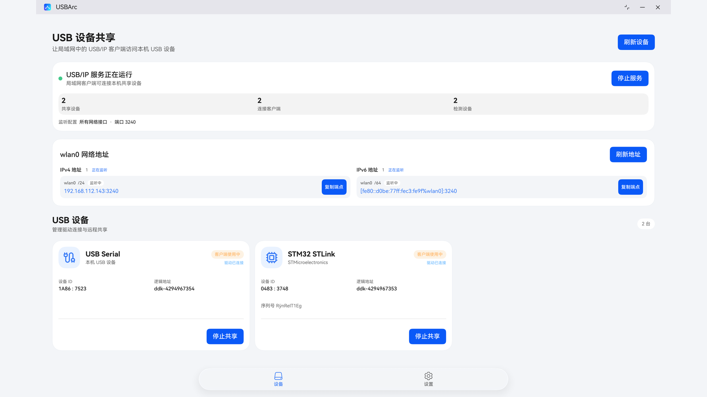
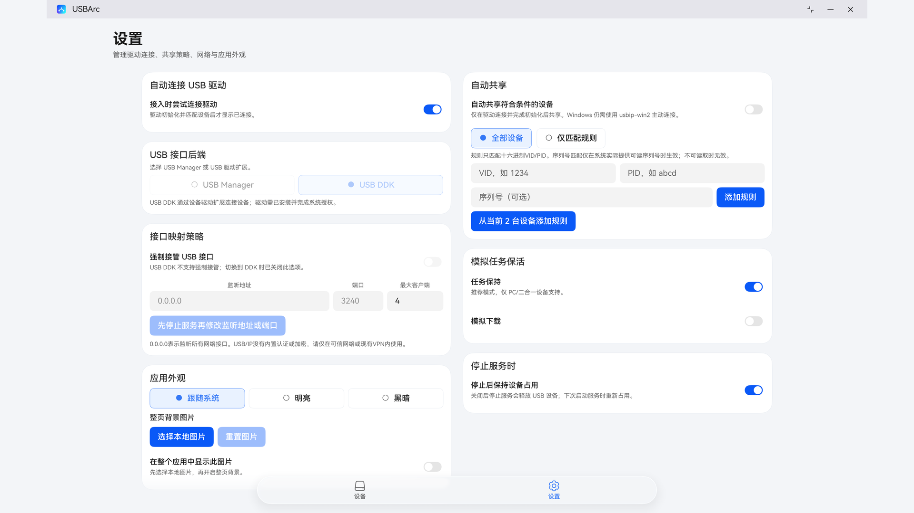
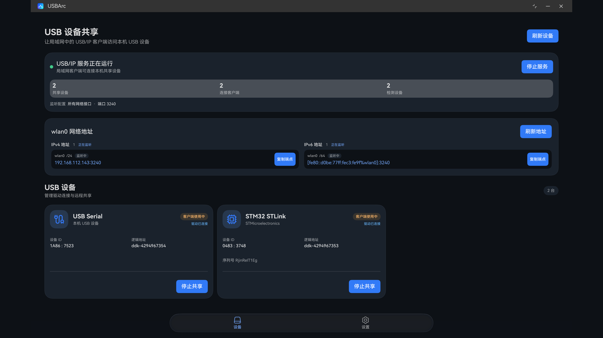

<div align="center">

[English](README.md) | **简体中文**

# USBArc


**面向 HarmonyOS 二合一设备的原生 USB/IP 服务端。**

> **DDK 访问要求：**当前合并版 HAP 声明 `ohos.permission.ACCESS_DDK_USB`，使用 DDK 后端需要获批的签名 Profile ACL。即使选择 USBManager，使用普通 Profile 安装此合并包仍未验证。当前实验性 DDK 后端由 ArkTS Worker 直接调用 NDK API，并未实现 `DriverExtensionAbility`。官方 DriverExtension 指南不能证明此 Worker 架构受平台支持，也不能证明其兼容所有设备。USBManager 本身不需要 DDK ACL；仅 USBManager 的构建应移除 `ACCESS_DDK_USB`，该配置尚未测试。

[](https://developer.huawei.com/consumer/cn/)
[](#兼容性与测试状态)
[](https://github.com/vadimgrn/usbip-win2)
[](#权限)

[源码仓库](https://github.com/RockyMtnWolf/USBArc) · [English](README.md)

</div>

---

USBArc 通过 USB/IP 1.1.1 共享连接到 HarmonyOS 二合一电脑的 USB 外设。Windows 客户端可使用 [usbip-win2](https://github.com/vadimgrn/usbip-win2) 查看并连接已共享设备。USBArc 是独立项目，不包含 MeshArc、Tailscale 或 VPN 功能。

## 功能

- **两种明确的设备后端：**普通应用路径为 USBManager；可选 DDK 后端需要获批 ACL 的签名 Profile，并由 ArkTS Worker 直接调用 NDK API。该实验路径仍待实机验证，且不会在 DDK 不可用时静默回退到 USBManager。
- **由用户控制访问：**可手动请求 USB 系统授权，也可启用自动请求。自动模式只向系统申请，不会静默批准设备。自动共享可选择全部设备或已保存的 VID/PID 规则。
- **桌面工作流：**自适应设备卡片、实时服务端和客户端状态、系统托盘与关闭到托盘。
- **网络地址显示：**分别显示检测到的本机 IPv4、IPv6 地址和监听配置；界面按服务端实际绑定的地址族报告监听状态。
- **可选后台任务请求：**任务保持与模拟数据传输任务。模拟模式不会下载文件，也不会伪造进度；系统可能取消任一任务。
- **外观：**跟随系统、明亮或黑暗主题，并可选择本地图片作为背景。

目标外设包括 USB 存储、J-Link、ST-Link、USB 转 TTL 适配器及 CDC 串口设备。实际兼容性取决于设备、接口描述符、后端和主机系统；这些类型不代表所有型号或传输方式都可用。

## 兼容性与测试状态

| 项目 | 支持情况 |
| --- | --- |
| 最低及目标 API | HarmonyOS API 26 |
| 声明的设备类型 | 仅二合一设备 |
| 验证使用的 USB/IP 客户端 | Windows `usbip-win2` |
| USB/IP 协议 | 1.1.1 |
| 等时传输 | 暂不支持 |

此前曾在 API 26 的 HUAWEI MateBook Pro S 上使用旧版 DDK 实现测试 CH340 USB 转串口和 ST-Link V2。Windows 对两台设备均报告 PnP `ProblemCode 0`；用户也确认通过 ST-Link 使用 STM32CubeProgrammer 成功读取。首次 ST-Link 连接曾出现超时，原因和复现情况仍在观察中。这些测试早于当前 Worker DDK 实现，不能验证当前实现；结果也仅适用于当时的设备与环境。

本轮另用 USBManager 测试 USB 存储共享：关闭强制接管时失败，用户显式开启后成功共享；随后关闭开关再次共享也成功。这支持初次失败时接口已被占用的判断。本轮只验证了服务端共享阶段，没有进行 Windows 客户端连接、磁盘访问或文件传输，因此 USB 存储数据传输仍未验证。

DDK 模式读取 USB 速度时，会在取得 USB 授权后临时打开只读 USBManager pipe，读取后立即关闭；USB 接口占用和数据传输仍由 DDK 完成。如果无法读取速度，设备不会导出，因为已测试的 Windows 客户端不接受未知速度。

## 安装

前往 [GitHub Releases](https://github.com/RockyMtnWolf/USBArc/releases) 获取未签名 HAP 和发布说明。设备通常要求安装包具有系统接受的签名；请使用自己获准使用的凭据签名。不要分享签名密钥或 Provisioning Profile。

USBManager API 本身不需要 DDK ACL。不过，当前合并版 HAP 仍声明 `ACCESS_DDK_USB`，因此即使选择 USBManager，使用普通 Profile 安装也尚未验证。使用可选 DDK 后端时，签名 Profile 必须包含获批的 `ohos.permission.ACCESS_DDK_USB` ACL。仅 USBManager 的构建应从源码移除 DDK 权限；当前代码不注册 `DriverExtensionAbility`，且仅 USBManager 的构建尚未测试。

## 构建

安装 DevEco Studio、HarmonyOS API 26 SDK 和 DevEco CLI。首次检出且尚无本地工程设置时，从仓库中的示例初始化：

```powershell
Copy-Item build-profile.example.json5 build-profile.json5
```

如果要将构建产物安装到设备，请自行配置本地签名。签名设置应留在本机，不要提交到版本库。然后在仓库根目录构建：

```powershell
devecocli build --modules entry --build-mode debug
```

构建 release `.app` 安装包：

```powershell
devecocli build --product default --build-mode release --assemble-type assembleApp
```

源码仓库不提供签名凭据。未签名的本地构建不一定能安装到设备。测试 DDK 时，应使用获批了 DDK ACL 的 Profile。

## 从 Windows 连接

在 USBArc 中启动服务、授权设备并选择共享，然后使用 USBArc 显示的地址和 bus ID：

```powershell
usbip.exe list -r <USBArc-address>
usbip.exe attach -r <USBArc-address> -b <bus-id>
```

默认端口为 `3240`。USBArc 仅在用户确认端口且系统成功绑定 socket 后开始监听。通过 MeshArc 连接时，也要在 MeshArc 的入站策略中放行该端口；USBArc 无法授予系统防火墙权限或其他应用的入站访问权限。USB/IP 本身不提供身份验证或加密。请使用可信网络或单独保护的隧道，不要将服务暴露在不可信网络中。

## 截图







## 权限

USB 设备授权、可选 DDK 访问、后台任务请求和网络监听是相互独立的控制项。当前 manifest 声明四项权限：

| 权限 | 保护级别 | 用途 |
| --- | --- | --- |
| `ohos.permission.INTERNET` | Normal，系统授予 | USB/IP 网络通信；不授予防火墙或入站网络批准。 |
| `ohos.permission.GET_NETWORK_INFO` | Normal，系统授予 | 读取活动网络和本机地址信息。 |
| `ohos.permission.KEEP_BACKGROUND_RUNNING` | Normal，系统授予 | 请求受支持的后台任务；系统可拒绝或取消。 |
| `ohos.permission.ACCESS_DDK_USB` | System-basic，系统授予，受限 ACL | 访问 USB DDK；需要获批的签名 Profile ACL。 |

manifest 不再声明 `ACCESS_EXTENSIONAL_DEVICE_DRIVER`。当前实验性 DDK Worker 直接调用 NDK API，而不是通过 `DriverExtensionAbility` 白名单流程；官方 DriverExtension 指南描述的是另一套架构，不能作为 Worker 受平台支持或兼容所有设备的证据。DDK ACL 仍需实机验证。USBManager 授权是独立的逐设备系统请求，不是 manifest 权限；仅 USBManager 的构建应移除 `ACCESS_DDK_USB`，但该配置尚未测试。后台任务确认和 TCP 入站/防火墙策略也独立于 manifest 权限。

## 许可证

USBArc 使用 [BSD 3-Clause License](LICENSE)。第三方组件声明见 [THIRD_PARTY_NOTICES.md](THIRD_PARTY_NOTICES.md)。

## 参考资料

- [HarmonyOS USB 服务概览](https://developer.huawei.com/consumer/en/doc/harmonyos-guides-V14/usb-overview-V14)
- [外设驱动开发与签名（DriverExtensionAbility 流程，与 USBArc Worker 架构不同）](https://developer.huawei.com/consumer/en/doc/harmonyos-guides-V13/driverextensionability-V13)
- [USB DDK 指南（OpenHarmony）](https://github.com/openharmony/docs/blob/master/zh-cn/application-dev/device/driver/usb-ddk-guidelines.md)
- [申请调试 Profile 与 ACL 权限](https://developer.huawei.com/consumer/cn/doc/doccenter-getting-started/agc-help-debug-profile-0000002248181278)
- [usbip-win2](https://github.com/vadimgrn/usbip-win2)
